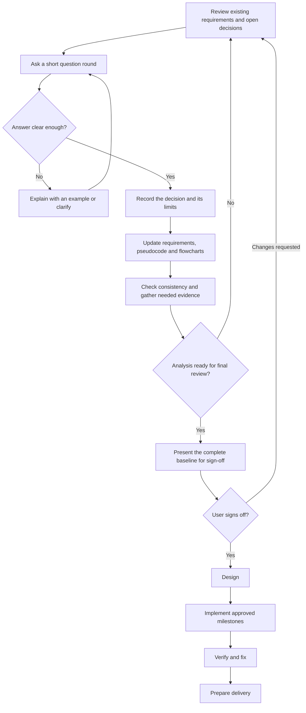

# EA: Guided Project Workflow

Updated 2026-09-19. Current phase: analysis, open and unfrozen.

The user asked the assistant to lead all project phases and use short rounds of
yes/no or elaboration questions to develop the documentation, pseudocode and
flowcharts. The assistant owns the drafting, technical investigation, consistency
work, implementation planning and verification. The user supplies preferences,
real examples and decisions that materially change the intended product.

This file tracks how we develop EA. Product requirements remain in the linked
analysis documents; this workflow does not add an EA feature or approve a baseline.

## Current Position

The existing foundation contains 35 proposed feature families, 39 scenarios,
111 acceptance criteria, 43 pseudocode sections and 65 flowchart views. All 69
checks in the ten JavaScript planning test files passed on 2026-09-19, running
each documented test file directly. These checks establish structural
consistency, not EA runtime behavior or human approval.

Analysis still needs detailed include/exclude decisions, supported formats and
platforms, defaults, identity/storage choices, licensing work, and measured
feasibility on 4 GB total RAM. No EA assistant runtime is implemented here.
The existing [analysis exit gates](brainstorm/END-STATE.md#analysis-exit-gates)
remain the completion criteria.

## Responsibilities Across Phases

| Phase | Assistant's work and reviewable output | User input |
| --- | --- | --- |
| Analysis — active | Turn real tasks into requirements, failure cases, pseudocode, diagrams and acceptance criteria; investigate feasibility and reconcile decisions | Answer short preference questions, correct examples, decide scope |
| Analysis completion — pending | Present the complete inventory, resolved decisions, feasibility evidence and remaining risks against G-01..08 | Review the concrete baseline and explicitly sign off when ready |
| Design — pending | Define architecture, interfaces, data structures, screen flows and implementation milestones within the approved scope | Resolve material experience or scope tradeoffs |
| Implementation — pending | Build the approved milestones, add appropriate tests and keep the specification aligned | Try demonstrations and clarify behavior when necessary |
| Verification — pending for EA | Check positive cases, failures, privacy, compatibility, resource use and acceptance criteria; fix failures | Judge usability and whether outcomes match the intended tasks |
| Delivery and maintenance — pending | Prepare installation, user documentation and release evidence; maintain approved behavior | Review the finished result and deployment or publication choices when needed |

Verification also happens during each earlier phase. Focused feasibility work
belongs inside analysis; it does not require a completed production application.
A first demonstration selects delivery order, not a smaller end-state inventory.
After sign-off, the existing freeze contract governs scope changes.

## Question And Document Cycle

Ask up to three related questions at a time. Use a clear yes/no choice where it
fits, offer a recommendation with a short reason, and allow a plain-language
example or elaboration. An explanation request gets an example before a decision
is recorded. Skipped or unanswered questions stay open while independent work
continues. Already confirmed requirements carry forward.

For each answer, record the actual choice, its limits and affected artifacts.
Translate it into the relevant requirement, scenario, pseudocode and flowchart
branches, including failure and cancellation behavior. Preserve unrelated manual
diagram edits. Summarize the resulting behavior for correction, run the relevant
checks and ask the next material questions. A question answer approves only that
choice; it does not sign off the entire analysis.

Technical investigation, routine implementation decisions and consistency fixes
belong to the assistant. Do not ask the user to choose a model, memory budget or
algorithm without first producing evidence and an understandable recommendation.

This diagram describes our development process. The questions and work proceed
across conversations; it is not an executable EA workflow.

## Decision Record: Round 1

The initial questions and the research privacy follow-up were answered on 2026-09-19. These are scoped product decisions; the analysis is not signed off.

| ID | Question | Recommendation or purpose | Status |
| --- | --- | --- | --- |
| Q-01 | What should EA demonstrate first? | Read permitted active screens, live alongside the user, and offer word/question research. Click or Super+Shift+8 toggles its panel; opted-in observation continues while hidden. Free use and KISS remain requirements. Exact demo apps are still to select. | Confirmed direction; feasibility pending |
| Q-02 | May EA offer unsolicited hints? | Yes, only after a separate opt-in. This includes F-29; it does not enable hints for a user, grant observation or start background research. | Confirmed included |
| Q-03 | Who opens menus? | The user opens menus; EA reads and guides. The proposed menu-reveal adapter is excluded from ZI. | Confirmed manual only |
| Q-04 | May EA fetch public research sources? | Yes; screen content and all AI processing stay on the device. This supersedes the earlier local/visible-only source restriction. Public queries/URLs need their own deliberate submission; no private-context egress or cloud inference. | Confirmed boundary |

The assistant recommends a local text model with bounded public-source retrieval,
not DeepSeek website automation. [Research evidence and open feasibility work](brainstorm/RESEARCH.md#companion-and-public-research-decision--2026-09-19)
record the tradeoffs. No provider/model has passed the 4 GB evaluation yet.

Round 2, Q-05 (confirmed 2026-09-19): saving observed screen history is **off by
default**. EA uses short-lived context in RAM, including while its panel is hidden
under a live observation grant. Enabling memory later applies only to future
observations; older temporary content is never saved retroactively. Exact cache
limits and optional saved-memory lifetimes remain to be measured or decided.

Round 2, Q-06 (asked 2026-09-19, awaiting answer): after setup, should EA start at
login with its panel hidden? Recommendation: yes, to support the requested
alongside-the-user experience. Starting EA never grants or renews observation;
the existing source permissions, activation and consent lifetime still apply.

Next rounds will follow these answers, covering everyday memory and privacy
defaults; exact apps, formats, languages and calculator domains; customization,
voice and companion preferences; and the remaining inventory and acceptance
decisions. The assistant will prepare technical recommendations and evidence
alongside those rounds. No new answer is inferred from silence or a recommendation.

## Artifact Map

| Artifact | Purpose |
| --- | --- |
| [Scope](brainstorm/ZI-SCOPE.md) and [complete inventory](brainstorm/END-STATE.md) | Product intent, boundaries, decisions and analysis exit gates |
| [Scenarios](brainstorm/SCENARIOS.md) and [settings](brainstorm/SETTINGS.md) | Concrete tasks, failures and user choices |
| [Pseudocode](brainstorm/PSEUDOCODE.md) | Detailed behavior and shared operation contracts |
| [Editable Archi board](brainstorm/assistant-expanded.archi.json) and [flow reference](brainstorm/FLOW-REFERENCE.md) | Authoritative saved diagrams and their readable reference |
| [Acceptance criteria](brainstorm/ACCEPTANCE.md) and [research](brainstorm/RESEARCH.md) | Expected outcomes, evidence and proposed feasibility experiments |
| [Alignment audit](brainstorm/ALIGNMENT.md) and [Document Sync](brainstorm/SYNC.md) | Cross-reference checks, remaining gaps and explicit semantic review |

The current analysis documents remain tracked in Archi Document Sync. This
development coordination file is a separate project record; accepted product
decisions must also reach the relevant tracked documents and diagram sources.
